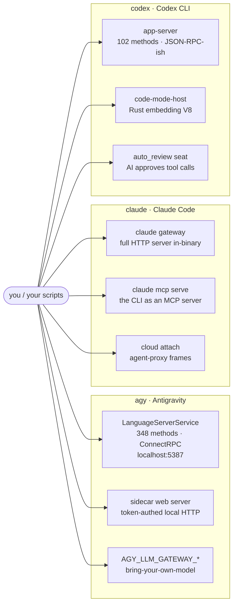
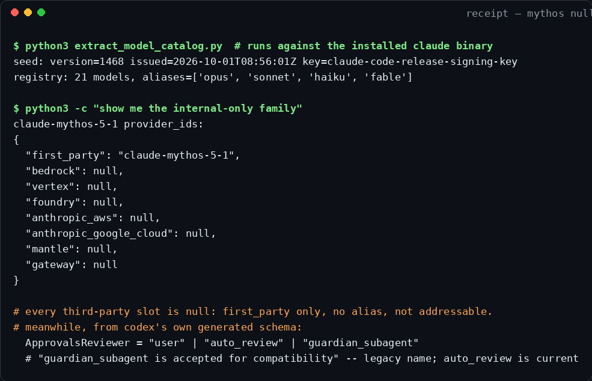

# agent-cli-internals

**Your AI coding tools look like chat boxes. Underneath, they're platforms with hidden control panels. This repo documents the panels.**

Four CLIs were taken apart byte by byte: Google's `agy` (Antigravity), Anthropic's `claude` (Claude Code), OpenAI's `codex`, and Meta's `muse` (Muse Code, prompts pass only). No agent was run and no prompt was sent to a model. Everything here comes from the text baked into the programs, the settings they ship with, and the self-describing specs some of them carry.

**Versions:** `agy` v1.3.1 · `claude` 2.1.287 · `codex` 0.155.1 · `muse` 1.4.7
**Also here:** [methodology](methodology/README.md) · [eureka log](eureka-log.md) · [PoCs](pocs/) · [diagrams](diagrams/) · [full prompt texts](prompts/) · [honesty box](#honesty-box) (caveats and what was not verified)

## The 30-second version

- **Antigravity exposes 889 RPC methods across 30 services**, including a 348-method local control server (`localhost:5387`) you can drive with curl. The binary prints the recipe.
- **Codex documents its own protocol.** One built-in command prints all 102 client-to-server API methods as JSON Schema.
- **Claude Code's 41MB app was carved out as readable JavaScript.** Permissions, settings, and cloud features are all searchable text now.
- **The binaries draw the public-vs-internal line themselves.** Mythos 5/5.1 is the internal-only model family; Fable 5/5.1 and GPT-6 Astra are public.
- **Every system prompt ships in the binary.** Full prompt corpora were extracted for all four tools (135 items): personas, safety judges, subagent libraries. One exception: Codex's Security Policy text is a runtime slot, not embedded.

## The three control planes at a glance


<details>
<summary>Diagram source (mermaid)</summary>



</details>

## What this unlocks (in plain English)

**1. Drive the Antigravity agent with plain web requests.** A local server exposes 348 control functions: start the agent, send messages, install plugins, open terminals. The program's own help text contains the exact curl recipe, so no SDK is needed. The full binary exposes 889 RPC methods across 30 services (finding #1).

**2. Codex prints its own instruction manual.** One built-in command emits all 102 client-to-server API methods as JSON Schema. Programmers stop guessing because the map comes from the tool itself.

**3. Claude Code's internals are now searchable text.** 41MB of internal JavaScript was pulled byte-exact from the binary. For permissions, settings, and cloud features, you can grep instead of guess.

**4. Public vs internal-only, read from the binary.** Mythos 5/5.1 has zero third-party provider IDs and no public alias; it is restricted to vetted partners. Fable 5/5.1 and GPT-6 Astra are public models whose catalog entries match the price lists.

**5. Antigravity's per-action safety screen, decoded.** A 3-stage pipeline runs before every tool call. It is configured from vendor servers, so the rules can change without an update. The override levers are mapped.

**6. Self-hostable servers inside the CLIs.** `claude gateway` is a complete HTTP server for routing AI traffic through your own infrastructure. Codex's code runner can point at a remote machine you own.

**7. An AI that approves the AI's tool calls.** Codex names an `auto_review` seat (legacy name: `guardian_subagent`), a prompted subagent that approves or denies tool calls in your place. The binary's own schema docs describe it as "a carefully prompted subagent to gather relevant context and apply a risk-based decision framework." The autonomy config ships today.

**8. Where your data goes, documented.** Antigravity has three telemetry pipelines and no program-level off switch. Codex analytics is off by default in the CLI (it only defaults on inside first-party hosts like the VS Code extension), while its OTel tracing is opt-in. Codex also phones home to a Sentry crash endpoint, a per-turn cost endpoint, and embeds `repo_hash` plus `line_fingerprints` in the analytics payload. Claude Code has a fully predictable permissions engine.

**9. The prompts the agents run on.** 135 prompts recovered verbatim: per-model system prompts and the full Guardian safety judge for Codex, the complete safety-judge texts and a hidden Teamwork swarm family for Antigravity, Claude Code's assembled prompt fragments (there is no single stored system prompt) plus its full security-review protocol, and Muse Code's main prompt in two editions.

## Receipts: cracked open, on the record

The internals were pulled out of the shipping binaries and then built on. This is a real terminal session against the installed `claude` binary:



Verbatim bytes from the binaries (offsets are in the finding docs):

```jsonc
// claude 2.1.287: the internal-only family. every third-party slot: null.
"claude-mythos-5-1": { "first_party": "claude-mythos-5-1",
  "bedrock": null, "vertex": null, "foundry": null,
  "anthropic_aws": null, "anthropic_google_cloud": null,
  "mantle": null, "gateway": null }
```

```jsonc
// codex: the binary's own schema describes who approves tool calls.
"ApprovalsReviewer": ["user", "auto_review", "guardian_subagent"]
// "auto_review uses a carefully prompted subagent to gather relevant context
//  and apply a risk-based decision framework... the legacy value
//  guardian_subagent is accepted for compatibility."
```

The carved sources are in [`carved/`](carved/): the Mythos registry entries as JSON, a slice of the minified shipped JS around the model-alias table (`best:"fable"`), and the opening of Antigravity's embedded 10.7KB safety pre-filter prompt, the secret rubric that screens every agent action.

[`pocs/`](pocs/) turns the findings into tools:

- a permission-rule **simulator** that predicts allow/deny before you run anything
- a settings **validator** against the recovered 183-key schema
- a surface **enumerator** for agy's control plane
- a model-catalog **differ** that flags new models, deprecations, and kill-switch flips on every future build

## Findings index, ranked by bigness

| # | Finding | Tool |
|---|---------|------|
| 1 | [The 889-method RPC service map: 30 services from codegen symbols](findings/antigravity/13-rpc-service-map.md) | agy |
| 2 | [Self-documenting protocol: 102 client-to-server methods from the binary's own schema generator](findings/codex/01-app-server-protocol.md) | codex |
| 3 | [The full prompt corpus: every system prompt the binary ships](findings/codex/14-prompt-corpus.md) (new: the vendor's own instruction text, byte-exact, including a per-model `instructions_template` for gpt-6-astra) | codex |
| 4 | [Entire app carved out as 41MB of searchable JavaScript](findings/claude-code/01-bundle-surgery.md) | claude |
| 5 | [The prompt corpus: no single system prompt, just style preambles plus shared sections](findings/claude-code/17-prompt-corpus.md) (new: proves the system prompt is assembled from fragments, not stored; full security-review protocol recovered) | claude |
| 6 | [Model families: Fable 5/5.1 (public) and Mythos 5/5.1 (internal-only)](findings/claude-code/10-fable-mythos.md) | claude |
| 7 | [Local control plane: 348 methods, drivable with curl](findings/antigravity/01-local-control-plane.md) | agy |
| 8 | [The prompt corpus: personas are templates, and a Teamwork swarm ships inside](findings/antigravity/16-prompt-corpus.md) (new: the safety judge's full decision text plus an undocumented multi-agent swarm family) | agy |
| 9 | [GrowthBook is the experiment SDK: every `tengu_*` gate is a GrowthBook evaluation](findings/claude-code/13-growthbook-experiment-sdk.md) | claude |
| 10 | [The autonomy roadmap is a config surface: six experimental structs, fully field-recovered](findings/codex/11-roadmap-struct-fields.md) | codex |
| 11 | [Gated rerun: an independent verifier re-checked 226 claims against the frozen bytes](findings/codex/15-gated-rerun.md) (new: 23 prior claims overturned, analytics default flipped, Sentry DSN and cost endpoint found) | codex |
| 12 | [Gateway is a full self-hostable HTTP server, not just auth](findings/claude-code/06-gateway-server.md) | claude |
| 13 | [Per-step safety screen: 3 monitors, server-overridable](findings/antigravity/02-safety-screen.md) | agy |
| 14 | [Muse Code: the main prompt ships in two editions, no dedicated safety prompt](findings/muse/01-prompt-corpus.md) (new: first byte-level look at Meta's coding CLI) | muse |
| 15 | [Code-mode host: a Rust binary embedding V8 that runs raw JS cells](findings/codex/04-code-mode-host.md) | codex |
| 16 | [Permission engine decoded: deny > ask > allow, simulated exactly](findings/claude-code/03-permission-engine.md) | claude |
| 17 | [Update signing (RSA-4096 SPKI), Datadog sink, event logging](findings/claude-code/16-update-signing-datadog.md) | claude |
| 18 | [Sanctioned bring-your-own-model path (`AGY_LLM_GATEWAY_*`)](findings/antigravity/12-byo-model-path.md) | agy |
| 19 | [Cloud Run auto-updater: the real update host](findings/antigravity/15-cloud-run-updater.md) | agy |
| 20 | [Rate limits are readable AND redeemable (idempotency-keyed reset credits)](findings/codex/07-rate-limits.md) | codex |
| 21 | [The CLI is its own MCP server; first-party Gmail/GCal hosts](findings/claude-code/07-mcp-plane.md) | claude |
| 22 | [Unleash: the second flag system](findings/antigravity/14-unleash-flag-system.md) | agy |
| 23 | [Gateway full route table (18 paths)](findings/claude-code/15-gateway-route-table.md) | claude |
| 24 | [The code-mode sandbox is exactly 14 injected names (and no more)](findings/codex/12-cell-globals.md) | codex |
| 25 | [Hidden commands + unregistered `claude daemon`](findings/claude-code/14-hidden-commands.md) | claude |
| 26 | [Telemetry: three pipelines, no program-level kill switch](findings/antigravity/05-telemetry.md) | agy |
| 27 | [The 0.149.0 → 0.155.1 feature-flag delta + hidden `--managed-daemon`](findings/codex/13-flag-delta-managed-daemon.md) | codex |

Full prompt texts live in [`prompts/`](prompts/). The other finding docs live under [`findings/antigravity/`](findings/antigravity/), [`findings/claude-code/`](findings/claude-code/), [`findings/codex/`](findings/codex/), and [`findings/muse/`](findings/muse/).

## For developers

- **[Methodology](methodology/README.md):** techniques per target (Go pclntab parsing, Bun string-table carving, schema-generator subcommands, control experiments) and the instrument list.
- **[Eureka log](eureka-log.md):** chronological breakthroughs, with the exact command, offset, or pattern that cracked each surface.
- **[Internal intel](internal-intel/):** codenames, roadmap signals, and kill switches per tool. CONFIRMED vs INFERENCE is labeled and kills are documented.
- **[PoCs](pocs/):** runnable scripts, organized per tool, all re-run and passing.
- Every finding doc follows one template: **1.** WHAT WAS FOUND · **2.** HOW IT WAS FOUND · **3.** WHAT IT UNLOCKS · **4.** HOW A DEVELOPER BUILDS ON IT.

## Honesty box

Method, version pins, re-verification, and what was not verified.

**Method.** Strings, schema, and behavioral tier only: read-only Python extraction, targeted offset reads, live `--help` introspection, and each binary's own schema generators. Zero network calls, zero metered-model quota burned, binaries never modified.

**Version pins.**

- `agy` v1.3.1 (sha256 `085f43e0…455ef`)
- `claude` 2.1.287 (244,317,368 bytes, Bun)
- `codex` 0.155.1 + `codex-code-mode-host` 69MB.
- `muse` 1.4.7 (`muse-bin-1.4.7-R6101.1`, 363,518,168 bytes). Prompts pass only (2026-10-20). Note: the app-server schema baseline was first captured against 0.149.0 and refreshed to a fresh 0.155.1 emission on the reinforcement pass (finding 13 documents the delta); `gpt-6-astra` is a 0.155.1-era addition.
- Trials re-ran 2026-10-18/19.

**Re-verification.** 38 of 39 trials CONFIRMED live against the installed binaries. 1 is PARTIAL: `claude mcp list` hangs doing live health checks (it functions, but is unbounded without a timeout). All PoCs exit 0. Each finding gives per-byte evidence (offsets, quoted literals) so claims can be re-derived.

**Reinforcement (2026-10-19, independent tools: reverify, yara, LIEF, raw pread).**

- 40 load-bearing claims re-verified (8 claude + 17 codex + 15 agy).
- **15 figures corrected:**
  - claude: 199→183 keys, 1965→2133 manifest rows, "128"→549 gates
  - codex: 95/10/75/1→102/10/82/1, 97/101→101/101 fields
  - agy: 341→348/350 methods, BOQ 18→19, secrets 2→3, hooks 7→6, env 42→43
- **9 claims downgraded/refuted**, including `sprofile` (never existed), the `[UNSTABLE] FOR OPENAI INTERNAL USE ONLY` marker (zero hits in 0.155.1), and bulk prior `@`-offsets on agy.
- **6/6 kills confirmed.**
- ~281 new CONFIRMED internals.
- The systemic cause of the count errors, lossy packed-string-run tokenizing, is documented in [methodology](methodology/README.md) with the correct methods.

**Gated rerun + prompt pass (2026-10-20, `local-re-swarm`).**

- Codex claims re-gated against the re-pinned binary by a verifier that did not produce them: 188 priors (80 VERIFIED, 40 CORROBORATED, 45 UNVERIFIED, **23 DISAGREEMENT**) and 38 new claims (32 VERIFIED, 3 CORROBORATED, 3 DISAGREEMENT).
- **Corrections folded into the docs in place, dated 2026-10-20:** analytics default direction (finding 08), six-variant login blob and no-`id_token` tokens run (finding 06), ShellEnvironmentPolicy field list (finding 05), the `updater failed` literal (finding 13). Finding 15 is the full ledger.
- Prompt corpora extracted for all four tools (135 items). Muse is new to the repo: prompts only, no control-plane or telemetry pass yet.

**What was NOT verified.**

- Wire behavior of any protocol. No network was allowed, so per-method auth, framing, and concurrency come from schemas and strings, not observation.
- A live Antigravity language server. Nothing was listening; probing it needs a running server with a valid CSRF token.
- Whether `AGY_CLI_DISABLE_SAFETY_FILTERING` is honored.
- Servability of Mythos 5 via any real API (internal-only). Fable 5/5.1 and GPT-6 Astra are public models; the open question there is plan-gated CLI access, not existence.
- Per-key config defaults (~90/101 codex keys).
- Numeric telemetry tunables.
- Chunk-manifest u32 semantics (5 hypotheses dead, not re-chased).
- Per-method auth on all surfaces.

Gaps are labeled in-line, never smoothed over.

**Limits of the record.** Codex scratchpads for lanes A, C, D, E were reconstructed post-hoc from the lane deliverables (honest reconstruction headers inside). Where a finding was refuted (Agy's `--disable_telemetry` CLI-flag claim; the "Fable 5/5.1 unreleased" framing), the refutation is kept in the repo as a kill. A documented kill is a finding.
