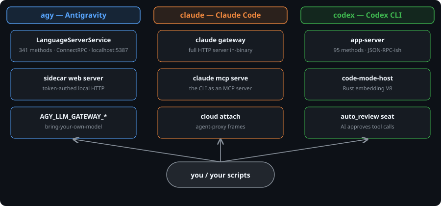

# agent-cli-internals

**Your AI coding tools look like chat boxes. Underneath, they're platforms with hidden control panels. This repo documents the panels.**

Three CLIs taken apart byte-by-byte — Google's `agy` (Antigravity), Anthropic's `claude` (Claude Code), OpenAI's `codex` — without running the agents or sending a single prompt to a model. Just the text baked into the programs, the settings they ship with, and the self-describing specs some of them carry.

`agy` v1.3.1 · `claude` 2.1.287 · `codex` 0.155.1 — [methodology](methodology/README.md) · [eureka log](eureka-log.md) · [PoCs](pocs/) · [diagrams](diagrams/)

## The 30-second version

- **Antigravity runs a 341-function control server on your own machine** (`localhost:5387`), drivable with curl. The binary prints the recipe.
- **Codex documents its own protocol**: one built-in command prints all 95 API methods as JSON Schema.
- **Claude Code's 41MB app was carved out as readable JavaScript** — permissions, settings, cloud, all searchable text now.
- **The binaries draw the public-vs-internal line themselves**: Mythos 5/5.1 is the genuinely internal-only model family; Fable 5/5.1 and GPT-6 Astra are public.

## The three control planes at a glance

Diagram source (mermaid)

## What this unlocks (in plain English)

**1. Drive the Antigravity agent from plain web requests.** 341 control functions on a local server — start the agent, send messages, install plugins, open terminals — and the program's own help text contains the exact curl recipe. No SDK needed.

**2. Codex prints its own instruction manual.** One built-in command emits all 95 API methods as JSON Schema. Programmers stop guessing; the map comes from the tool itself.

**3. Claude Code's brain is now searchable text.** 41MB of internal JavaScript pulled byte-exact from the binary. Permissions, settings, cloud features — grep instead of guess.

**4. Public vs internal-only, straight from the binary.** Mythos 5/5.1: zero third-party provider IDs, no public alias — restricted to vetted partners. Fable 5/5.1 and GPT-6 Astra: public models whose catalog entries match the price lists.

**5. Antigravity's per-action safety screen, decoded.** A 3-stage pipeline runs before every tool call, configured from vendor servers — rules can change without an update. The override levers are mapped.

**6. Self-hostable servers hiding inside the CLIs.** `claude gateway` is a complete HTTP server for routing AI traffic through your own infrastructure. Codex's code-runner can point at a remote machine you own.

**7. The AI that approves the AI's tool calls.** Codex names an `auto_review` seat (legacy name: `guardian_subagent`): a prompted subagent that approves or denies tool calls instead of you — "a carefully prompted subagent to gather relevant context and apply a risk-based decision framework," per the binary's own schema docs. The autonomy config ships today.

**8. Where your data goes, documented.** Antigravity: three telemetry pipelines, no program-level off switch. Codex: opt-in tracing vs always-on analytics (which has an off switch). Claude Code: a fully predictable permissions engine.

## Findings index, ranked by bigness

| # | Finding | Tool |
|---|---------|------|
| 1 | [Local control plane: 341 methods, drivable with curl](findings/antigravity/01-local-control-plane.md) | agy |
| 2 | [Self-documenting protocol: 95 methods from the binary's own schema generator](findings/codex/01-app-server-protocol.md) | codex |
| 3 | [Entire app carved out as 41MB of searchable JavaScript](findings/claude-code/01-bundle-surgery.md) | claude |
| 4 | [Model families: Fable 5/5.1 (public) and Mythos 5/5.1 (internal-only)](findings/claude-code/10-fable-mythos.md) | claude |
| 5 | [Per-step safety screen: 3 monitors, server-overridable](findings/antigravity/02-safety-screen.md) | agy |
| 6 | [Gateway is a full self-hostable HTTP server, not just auth](findings/claude-code/06-gateway-server.md) | claude |
| 7 | [Code-mode host: a Rust binary embedding V8 that runs raw JS cells](findings/codex/04-code-mode-host.md) | codex |
| 8 | [Permission engine decoded: deny > ask > allow, simulated exactly](findings/claude-code/03-permission-engine.md) | claude |
| 9 | [Sanctioned bring-your-own-model path (`AGY_LLM_GATEWAY_*`)](findings/antigravity/12-byo-model-path.md) | agy |
| 10 | [Rate limits are readable AND redeemable (idempotency-keyed reset credits)](findings/codex/07-rate-limits.md) | codex |
| 11 | [The CLI is its own MCP server; first-party Gmail/GCal hosts](findings/claude-code/07-mcp-plane.md) | claude |
| 12 | [Telemetry: three pipelines, no program-level kill switch](findings/antigravity/05-telemetry.md) | agy |

## For developers

- **[Methodology](methodology/README.md)** — techniques per target (Go pclntab parsing, Bun string-table carving, schema-generator subcommands, control experiments) and the instrument list.
- **[Eureka log](eureka-log.md)** — chronological breakthroughs with the exact command, offset, or pattern that cracked each surface.
- **[Internal intel](internal-intel/)** — codenames, roadmap signals, kill switches per tool; CONFIRMED vs INFERENCE labeled, kills documented.
- **[PoCs](pocs/)** — runnable scripts, all re-run and passing, organized per tool.
- Every finding doc follows one template: **1.** WHAT WAS FOUND · **2.** HOW IT WAS FOUND · **3.** WHAT IT UNLOCKS · **4.** HOW A DEVELOPER BUILDS ON IT.

<strong>Honesty box</strong> — method, version pins, what wasn't verified (click to expand)

**Method:** strings/schema/behavioral tier only. Read-only Python extraction, targeted offset reads, live `--help` introspection, each binary's own schema generators. Zero network calls, zero metered-model quota burned, binaries never modified.

**Version pins:** `agy` v1.3.1 (sha256 `085f43e0…455ef`) · `claude` 2.1.287 (244,317,368 bytes, Bun) · `codex` 0.155.1 + `codex-code-mode-host` 69MB (note: the app-server schema and feature-flag baselines were captured against 0.149.0; the trial found `gpt-6-astra` is a 0.155.1-era addition). Trials re-ran 2026-10-18/19.

**Re-verification:** 38 of 39 trials CONFIRMED live against the installed binaries; 1 PARTIAL (`claude mcp list` hangs doing live health checks — functions, but unbounded without a timeout). All PoCs exit 0. Per-byte evidence (offsets, quoted literals) is given in each finding so claims can be re-derived.

**What was NOT verified:** wire behavior of any protocol (no network allowed — per-method auth, framing, concurrency are from schemas/strings, not observation); a live Antigravity language server (nothing was listening — probing it needs a running server with a valid CSRF token); whether `AGY_CLI_DISABLE_SAFETY_FILTERING` is honored; servability of Mythos 5 via any real API (internal-only; Fable 5/5.1 and GPT-6 Astra are public models — the open question there is plan-gated CLI access, not existence); per-key config defaults (~90/101 keys each); numeric telemetry tunables. Gaps are labeled in-line, never smoothed over.

**Limits of the record:** Codex scratchpads for lanes A, C, D, E were reconstructed post-hoc from the lane deliverables (honest reconstruction headers inside). Where a finding was refuted (Agy's `--disable_telemetry` CLI-flag claim; the "Fable 5/5.1 unreleased" framing), the refutation is kept in the repo as a kill — a documented kill is a finding.

